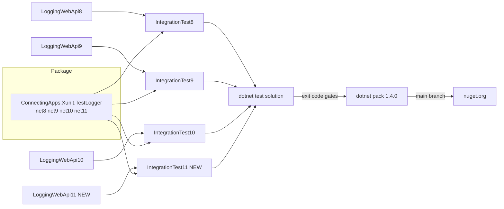

# Requirements

### Overview & Goals

`ConnectingApps.Xunit.TestLogger` currently ships for `net8.0;net9.0;net10.0` and has **no .NET 11 support at all**. At the same time, the existing integration tests only assert `HttpStatusCode.OK` — nothing verifies that log output actually reaches the xUnit test output, so the package's core feature is validated by looking at a screenshot, not by CI.

Goals:

1. Add first-class **.NET 11** support to the package (new `net11.0` target + a .NET 11 sample API + .NET 11 integration tests).
2. Make the tests for **all four versions (8, 9, 10, 11) actually prove what their names claim** — fully automated, no human inspection of the test output.
3. Make the GitHub pipeline build, test and publish all four targets reliably, and publish a new NuGet version (`1.4.0` — confirmed by the maintainer as the intended, not-yet-published version, so no nuget.org pre-check is part of this work).

### Scope

**In scope**

- `ConnectingApps.Xunit.TestLogger.csproj`: add `net11.0` to `TargetFrameworks` with a pinned `Microsoft.AspNetCore.Mvc.Testing` `[11.0.0, 11.0.99]`, bump `Version` to `1.4.0`, update `PackageReleaseNotes`.
- New `ConnectingApps.LoggingWebApi11` sample Web API (mirror of `ConnectingApps.LoggingWebApi10`, controller-based, `Microsoft.AspNetCore.OpenApi` 11.0.0).
- New `ConnectingApps.LoggingWebApi.IntegrationTest11` xUnit project; both new projects registered in `Xunit.TestLogger.sln`.
- Strengthened assertions in `ImprovedLoggingTest` and `NoLoggingTests` in **all four** integration test projects.
- `.github/workflows/dotnet-desktop.yml`: install the `11.0.x` SDK, stop swallowing the `dotnet test` exit code, bump all actions to current (Node 24) majors.
- `README.md`: document supported target frameworks and how to assert logs.
- Bump `Microsoft.AspNetCore.OpenApi` in the net10 sample from `10.0.0` to `10.0.15` to clear the `NU1903` advisory on `Microsoft.OpenApi` 2.0.0 that restore reports today.

**Out of scope**

- Dropping .NET 8 / .NET 9 (both went end-of-support on 10 Nov 2026) — they stay, as requested.
- Migrating to xUnit v3 (`xunit.abstractions` tops out at 2.0.3; the public API stays xUnit v2-based).
- Any change to the public API of `TestLoggerWebApplicationFactory`, `TestLoggerProvider` or `XunitTestLogger`.
- Changing the release trigger: publishing stays "push to `main`".
- A pre-publish availability check for `1.4.0` on nuget.org — the maintainer has confirmed `1.4.0` is the intended new version and does not exist yet.

### User Stories

- As a consumer on .NET 11, I want `TestLoggerWebApplicationFactory<Program>(output)` to work from a `net11.0` test project, so that I see my app's logging in xUnit output without downgrading.
- As the package maintainer, I want CI to fail when the logging feature breaks on any of .NET 8/9/10/11, so that a broken package can never reach NuGet.
- As the package maintainer, I want one green pipeline run on `main` to produce and push version `1.4.0` to NuGet.

### Functional Requirements

1. `dotnet pack` produces a package containing `lib/net8.0`, `lib/net9.0`, `lib/net10.0` **and** `lib/net11.0`, each with the matching `Microsoft.AspNetCore.Mvc.Testing` dependency range.
2. A `net11.0` xUnit project referencing the library compiles and runs integration tests against a `net11.0` ASP.NET Core app.
3. For every version 8/9/10/11, `ImprovedLoggingTest` asserts that the application's log line `"This should be logged during testing"` arrives in the xUnit output **in the package's exact format** `yyyy-MM-dd HH:mm:ss [Level] message`, and that `TestLoggerProvider` is registered in the app's DI container.
4. For every version 8/9/10/11, `NoLoggingTests` asserts the inverse contract: a plain `WebApplicationFactory<Program>` does **not** register `TestLoggerProvider`, while the endpoint still returns `200 OK`.
5. Test code keeps the shape documented in the README — the factory is still constructed from the injected `ITestOutputHelper`, and log lines are still printed to the real test output.
6. `dotnet test Xunit.TestLogger.sln` runs all four test projects, and a failing test fails the workflow job and blocks packaging/publishing.
7. The workflow installs SDKs `8.0.x`, `9.0.x`, `10.0.x`, `11.0.x` and publishes `1.4.0` to NuGet on `main`.

### Non-Functional Requirements

- No new public API surface in the NuGet package; existing consumer code keeps compiling unchanged.
- `dotnet restore` of the solution finishes with no `NU1903` vulnerability warnings.
- All GitHub Actions used run on the Node 24 runtime (Node 20 was removed from GitHub runners on 16 Sep 2026).

# Technical Design

### Current Implementation

- **Library** — `ConnectingApps.Xunit.TestLogger/` holds three small files: `TestLoggerWebApplicationFactory.cs` (registers `ILoggerProvider` → `TestLoggerProvider` in `ConfigureWebHost`), `TestLoggerProvider.cs` (creates `XunitTestLogger`), `XunitTestLogger.cs` (formats `$"{DateTime.UtcNow:yyyy-MM-dd HH:mm:ss} [{logLevel}] {formatter(state, exception)}"` and calls `ITestOutputHelper.WriteLine`). `TargetFrameworks` = `net10.0;net9.0;net8.0`, `Version` = `1.3.1`, with one conditioned `ItemGroup` per TFM pinning `Microsoft.AspNetCore.Mvc.Testing` to `[X.0.0, X.0.99]`.
- **Samples** — `ConnectingApps.LoggingWebApi8/9` are minimal-API templates; `ConnectingApps.LoggingWebApi10` is controller-based (`Controllers/WeatherForecastController.cs`, `WeatherForecast.cs`, `AddOpenApi()`). All three log `"This should be logged during testing"` on `GET /weatherforecast` and expose their implicit `Program` type via `InternalsVisibleTo`.
- **Tests** — `ConnectingApps.LoggingWebApi.IntegrationTest8/9/10` each duplicate `ImprovedLoggingTest.cs` + `NoLoggingTests.cs`, assert only the status code, and reference the library and their sample API by `ProjectReference`.
- **CI** — `.github/workflows/dotnet-desktop.yml`: one `build_and_test` job (two `setup-dotnet` steps, the second installing 8/9/10) and a `package` job that packs and pushes to NuGet on `main`.

Verified during investigation (SDK 11.0.100 present, ASP.NET Core runtimes 8.0.34/9.0.23/10.0.5/11.0.0 installed locally): the solution builds and all 6 existing tests pass; restore emits `NU1903` for `Microsoft.OpenApi` 2.0.0 via `Microsoft.AspNetCore.OpenApi` 10.0.0. A forced restore of the throwaway `net11.0` probe (with `Microsoft.AspNetCore.OpenApi` 11.0.0) reported no advisories, so the new net11 sample needs no extra dependency pin. The GitHub Action majors used in the plan (`checkout@v7`, `setup-dotnet@v6`, `upload-artifact@v7`, `test-reporter@v3`) were confirmed to exist and to run on `node24`.

### Key Decisions

1. **Add a real `net11.0` TFM rather than relying on roll-forward.** Proven out-of-tree: a `net11.0` build of the three library files against `Microsoft.AspNetCore.Mvc.Testing` `[11.0.0, 11.0.99]` + `xunit.abstractions` 2.0.3, consumed from a `net11.0` xUnit project, works with **zero source changes**. Without the TFM a net11 consumer silently resolves the net10 asset and drags ASP.NET Core 10 testing packages into a net11 app.
2. **Assertions live in the test projects, not in the package.** A ~20-line `CapturingTestOutputHelper : ITestOutputHelper` decorator records every line and forwards to the real helper, so the visible test output (the README screenshot) is unchanged and no new public API has to be supported forever.
3. **The helper is duplicated per test project**, exactly like `ImprovedLoggingTest.cs`/`NoLoggingTests.cs` are today. Each versioned test project stays self-contained and compiles for its own TFM; no new shared-source or `Directory.Build.props` machinery is introduced.
4. **`NoLoggingTests` asserts a non-tautological contract.** Simply checking "nothing was captured" on an object never handed to the app proves nothing; instead both tests inspect `factory.Services.GetServices<ILoggerProvider>()` — `TestLoggerProvider` must be present with `TestLoggerWebApplicationFactory` and absent with a plain `WebApplicationFactory`.
5. **Single CI job with four SDKs** (your choice) — smallest diff from today's pipeline, one `dotnet test` over the solution covers all four TFMs.
6. **The `dotnet test` exit code must propagate.** Today the step is `python -c "import os; os.system('dotnet test ...')"`, and `os.system`'s return value is discarded, so Python always exits `0` — failing tests cannot fail the job and cannot stop the NuGet push. This is replaced by a plain `dotnet test` step.
7. **Version `1.4.0`** (additive support, matching the `1.2.x → 1.3.1` pattern used for the .NET 9/10 releases) with `PackageReleaseNotes` = `Full Support for .NET 11`. The maintainer has confirmed `1.4.0` is the intended new version and is not on nuget.org yet, so no pre-publish availability check is planned.

### Proposed Changes

**1 — Library targets .NET 11** (`ConnectingApps.Xunit.TestLogger.csproj`)

- `<TargetFrameworks>net11.0;net10.0;net9.0;net8.0</TargetFrameworks>`.
- New conditioned `ItemGroup` for `net11.0` mirroring the existing ones:
  `Microsoft.AspNetCore.Mvc.Testing` `[11.0.0, 11.0.99]` + `xunit.abstractions` `[2.0.3, 3.2.0]`.
- `<Version>1.4.0</Version>`, `<PackageReleaseNotes>Full Support for .NET 11</PackageReleaseNotes>`.
- No `.cs` changes.

**2 — .NET 11 sample + test projects**

- `ConnectingApps.LoggingWebApi11` mirrors `ConnectingApps.LoggingWebApi10` one-for-one (`Program.cs`, `Controllers/WeatherForecastController.cs` logging the same marker string, `WeatherForecast.cs`, `appsettings*.json`, `Properties/launchSettings.json`, `.http`), with `TargetFramework` = `net11.0`, `Microsoft.AspNetCore.OpenApi` `11.0.0`, and `InternalsVisibleTo` → `ConnectingApps.LoggingWebApi.IntegrationTest11`.
- `ConnectingApps.LoggingWebApi.IntegrationTest11` mirrors the net10 test project, with the tooling validated in the probe: `Microsoft.NET.Test.Sdk` 17.14.1, `xunit` 2.9.3, `xunit.runner.visualstudio` 3.1.4, `coverlet.collector` 6.0.4, `IsPackable=false`, `IsTestProject=true`, `GlobalUsings.cs`.
- Both added to `Xunit.TestLogger.sln` with fresh GUIDs and Debug/Release `Any CPU` mappings; `IsTestProject` is also added to the net10 test project, which is missing it today.

**3 — Tests that prove the contract (× 4 versions)**

- Add `CapturingTestOutputHelper.cs` to each of the four test projects.
- `ImprovedLoggingTest` keeps its current shape, wrapping the injected helper before handing it to the factory, and additionally asserts the formatted line and the DI registration.
- `NoLoggingTests` additionally asserts that `TestLoggerProvider` is **not** registered by a plain `WebApplicationFactory`.
- Each project also gets one direct check of the formatting contract (`TestLoggerProvider.CreateLogger(...)` → `[Warning]` line, `IsEnabled` true for every level), so a regression in `XunitTestLogger` fails per TFM without needing a new unit-test project.

**4 — Workflow** (`.github/workflows/dotnet-desktop.yml`)

- Add `11.0.x` to the SDK list in both jobs; drop the redundant first `setup-dotnet` step, the stray `echo Hello, ${{ vars.PUBLISH_NUGET }}` step and the unused `OPENAI_KEY` env.
- Replace the Python-wrapped test command with `dotnet test Xunit.TestLogger.sln --configuration Release --no-build --verbosity normal --logger trx`.
- Bump `actions/checkout@v4 → v7`, `actions/setup-dotnet@v4 → v6`, `actions/upload-artifact@v4 → v7`, `dorny/test-reporter@v1 → v3`; add `permissions: { contents: read, checks: write }` required by the reporter, and `if: always()` on the two reporting steps so results still publish when tests fail.

**5 — Docs & hygiene**

- `README.md`: a "Supported frameworks" line for .NET 8/9/10/11 and a short snippet showing how to assert captured log lines.
- `ConnectingApps.LoggingWebApi10.csproj`: `Microsoft.AspNetCore.OpenApi` `10.0.0 → 10.0.15` (its `Microsoft.OpenApi` dependency becomes `[2.13.0, 3.0.0)`, clearing `NU1903`).

### Data Models / Contracts

```csharp
// Added to each of the four integration test projects (same file, per-project copy)
public sealed class CapturingTestOutputHelper : ITestOutputHelper
{
    private readonly ITestOutputHelper _inner;
    private readonly List<string> _lines = new();

    public CapturingTestOutputHelper(ITestOutputHelper inner) => _inner = inner;

    public IReadOnlyList<string> Lines { get { lock (_lines) { return _lines.ToArray(); } } }

    public void WriteLine(string message)
    {
        lock (_lines) { _lines.Add(message); }
        _inner.WriteLine(message); // real xUnit output is still produced
    }

    public void WriteLine(string format, params object[] args) => WriteLine(string.Format(format, args));
}
```

```csharp
// ImprovedLoggingTest – unchanged usage shape, real assertions
_capture = new CapturingTestOutputHelper(output);
_factory = new TestLoggerWebApplicationFactory<Program>(_capture);

var response = await _client.GetAsync("/weatherforecast");
Assert.Equal(HttpStatusCode.OK, response.StatusCode);
Assert.Contains(_capture.Lines, l => Regex.IsMatch(
    l, @"^\d{4}-\d{2}-\d{2} \d{2}:\d{2}:\d{2} \[Information\] This should be logged during testing$"));
Assert.Contains(_factory.Services.GetServices<ILoggerProvider>(), p => p is TestLoggerProvider);

// NoLoggingTests – the inverse contract
Assert.DoesNotContain(_factory.Services.GetServices<ILoggerProvider>(), p => p is TestLoggerProvider);
```

All of the above (including the regex and both DI assertions) was executed successfully against a throwaway `net11.0` copy of the library during planning.

### File Structure

```
ConnectingApps.Xunit.TestLogger/
  ConnectingApps.Xunit.TestLogger.csproj        # modified: +net11.0, 1.4.0, release notes
ConnectingApps.LoggingWebApi11/                 # NEW (mirror of ...WebApi10)
  ConnectingApps.LoggingWebApi11.csproj
  Program.cs, WeatherForecast.cs, Controllers/WeatherForecastController.cs
  appsettings.json, appsettings.Development.json, Properties/launchSettings.json,
  ConnectingApps.LoggingWebApi11.http
ConnectingApps.LoggingWebApi.IntegrationTest11/ # NEW (mirror of ...IntegrationTest10)
  ConnectingApps.LoggingWebApi.IntegrationTest11.csproj
  GlobalUsings.cs, ImprovedLoggingTest.cs, NoLoggingTests.cs, CapturingTestOutputHelper.cs
ConnectingApps.LoggingWebApi.IntegrationTest8/  # modified: assertions + CapturingTestOutputHelper.cs
ConnectingApps.LoggingWebApi.IntegrationTest9/  # modified: assertions + CapturingTestOutputHelper.cs
ConnectingApps.LoggingWebApi.IntegrationTest10/ # modified: assertions + CapturingTestOutputHelper.cs, +IsTestProject
ConnectingApps.LoggingWebApi10/                 # modified: OpenApi 10.0.0 -> 10.0.15
Xunit.TestLogger.sln                            # modified: +2 projects
.github/workflows/dotnet-desktop.yml            # modified: +11.0.x SDK, real exit code, action bumps
README.md                                       # modified: supported frameworks + assertion example
```

### Architecture Diagram



### Risks

- **.NET 8/9 are end-of-support (10 Nov 2026).** Explicit `8.0.x`/`9.0.x` entries in `setup-dotnet` still install them (last patches 8.0.34 / 9.0.23), but quality/`latest`-based resolution excludes EOL channels — so the SDK list must stay pinned to explicit majors. Local runs need the ASP.NET Core 8.0/9.0 runtimes present (installed via `dotnet-install.sh --channel 8.0 --runtime aspnetcore` during planning).
- **Publishing is automatic on `main`.** The first green `main` run pushes `1.4.0` to NuGet (confirmed by the maintainer as the intended, unpublished version). The exit-code fix and the version bump land in the same change, so a red test run can never reach NuGet.
- **`dorny/test-reporter@v3`** needs `checks: write`; without the added `permissions` block the reporting step fails on a repo with default read-only tokens.
- **xUnit v2 ceiling** — `xunit.abstractions` 2.0.3 is the newest; consumers on xUnit v3 (`Xunit.ITestOutputHelper`) remain unsupported, unchanged from today.
- **Log-line timing** — the assertions read `Lines` after `await GetAsync(...)`, when the request has completed; the capture list is lock-guarded because ASP.NET Core may log from background threads.

# Testing

### Validation Approach

Everything is verified by `dotnet` commands only — no screenshots, no manual output reading:

1. `dotnet restore Xunit.TestLogger.sln` — expect **no** `NU1903` warnings after the `Microsoft.AspNetCore.OpenApi` bump.
2. `dotnet build Xunit.TestLogger.sln -c Release` — expect `lib` outputs for `net8.0`, `net9.0`, `net10.0`, `net11.0` plus all 8 sample/test assemblies.
3. `dotnet test Xunit.TestLogger.sln -c Release --no-build` — expect all four test projects to run green (ASP.NET Core runtimes 8.0/9.0/10.0/11.0 must be installed; use `dotnet-install.sh --channel <X> --runtime aspnetcore` if missing).
4. `dotnet pack ConnectingApps.Xunit.TestLogger/... -c Release -o out` then `unzip -l out/*.1.4.0.nupkg` — assert the four `lib/<tfm>/` folders and inspect the `.nuspec` dependency groups per TFM.
5. Mutation-style sanity check: temporarily comment out the `_logger.LogInformation(...)` line in one sample API and confirm that version's `ImprovedLoggingTest` **fails** — proving the assertion is real and not vacuous; then revert.

### Key Scenarios

| Scenario | Expected outcome |
|---|---|
| `ImprovedLoggingTest` on net8/9/10/11 | `200 OK`, a captured line matching `^\d{4}-\d{2}-\d{2} \d{2}:\d{2}:\d{2} \[Information\] This should be logged during testing$`, and `TestLoggerProvider` present in `factory.Services.GetServices<ILoggerProvider>()` |
| `NoLoggingTests` on net8/9/10/11 | `200 OK` and **no** `TestLoggerProvider` registered |
| Direct formatting check on net8/9/10/11 | `TestLoggerProvider.CreateLogger("Cat").LogWarning("hello {Name}", "world")` writes exactly one line matching `… [Warning] hello world`; `IsEnabled` is `true` for every `LogLevel` |
| Packaging | `.nupkg` contains `lib/net11.0` with `Microsoft.AspNetCore.Mvc.Testing [11.0.0, 11.0.99]` |
| Workflow | Four SDKs listed by `dotnet --list-sdks`; a deliberately failing test makes the `build_and_test` job red and prevents the `package` job from running |

### Edge Cases

- **Vacuous assertions** — guarded by the mutation check above and by `Assert.Single` on the direct formatting test.
- **Concurrent writes** — `CapturingTestOutputHelper` locks its backing list so framework logging from background threads cannot corrupt it or cause flaky `Lines` snapshots.
- **Forwarding regression** — the wrapper still calls the inner helper, so the human-readable output shown in the README screenshot stays intact; visually spot-checked once via `--logger "console;verbosity=detailed"`.
- **Missing runtime on a clean machine** — a `net11.0`-only or `net10.0`-only machine aborts the 8/9 test runs with "You must install or update .NET"; the fix is installing the ASP.NET Core runtimes, which is also what `setup-dotnet` does on the runner.

### Test Changes

- **Added:** `CapturingTestOutputHelper.cs` in all four integration test projects; `ImprovedLoggingTest.cs`, `NoLoggingTests.cs`, `GlobalUsings.cs` in the new `ConnectingApps.LoggingWebApi.IntegrationTest11`.
- **Updated:** `ImprovedLoggingTest.cs` and `NoLoggingTests.cs` in `IntegrationTest8/9/10` gain the log-content, format and DI assertions; `IntegrationTest10.csproj` gains `IsTestProject`.
- **Not added:** a separate unit-test project — the per-TFM formatting checks live inside the existing versioned test projects (a standalone unit-test project was deliberately removed from this repo earlier).

# Delivery Steps

### ✓ Step 1: Add .NET 11 target to the NuGet package
The package builds for `net11.0` alongside 8/9/10 and `dotnet pack` emits a `1.4.0` package with four `lib` folders.

- Edit `ConnectingApps.Xunit.TestLogger/ConnectingApps.Xunit.TestLogger.csproj`: set `<TargetFrameworks>net11.0;net10.0;net9.0;net8.0</TargetFrameworks>`.
- Add a conditioned `ItemGroup` for `'$(TargetFramework)' == 'net11.0'` mirroring the existing ones: `Microsoft.AspNetCore.Mvc.Testing` `[11.0.0, 11.0.99]` and `xunit.abstractions` `[2.0.3, 3.2.0]`.
- Bump `<Version>` to `1.4.0` and set `<PackageReleaseNotes>Full Support for .NET 11</PackageReleaseNotes>`.
- Leave `TestLoggerWebApplicationFactory.cs`, `TestLoggerProvider.cs` and `XunitTestLogger.cs` untouched — a throwaway net11.0 build during planning proved no source change is needed.
- Verify with `dotnet build -c Release` (expect `bin/Release/net11.0/ConnectingApps.Xunit.TestLogger.dll`) and `dotnet pack -c Release -o out`, then list the `.nupkg` contents to confirm `lib/net8.0`, `lib/net9.0`, `lib/net10.0`, `lib/net11.0` and the per-TFM dependency groups.

### ✓ Step 2: Create the .NET 11 sample API and integration test project
A `net11.0` sample API and its xUnit project exist, are part of the solution, and their tests run green.

- Create `ConnectingApps.LoggingWebApi11/` as a one-for-one mirror of `ConnectingApps.LoggingWebApi10/`: `Program.cs`, `Controllers/WeatherForecastController.cs` (logging the same `"This should be logged during testing"` marker), `WeatherForecast.cs`, `appsettings.json`, `appsettings.Development.json`, `Properties/launchSettings.json`, `.http` file.
- Its csproj targets `net11.0`, references `Microsoft.AspNetCore.OpenApi` `11.0.0`, and declares `InternalsVisibleTo` for `ConnectingApps.LoggingWebApi.IntegrationTest11`.
- Create `ConnectingApps.LoggingWebApi.IntegrationTest11/` mirroring the net10 test project with `Microsoft.NET.Test.Sdk` 17.14.1, `xunit` 2.9.3, `xunit.runner.visualstudio` 3.1.4, `coverlet.collector` 6.0.4, `IsPackable=false`, `IsTestProject=true`, `GlobalUsings.cs`, and project references to the net11 API and the library.
- Port `ImprovedLoggingTest.cs` and `NoLoggingTests.cs` into it under the `ConnectingApps.LoggingWebApi.IntegrationTest11` namespace.
- Register both projects in `Xunit.TestLogger.sln` with new GUIDs and Debug/Release `Any CPU` configuration mappings.
- Verify with `dotnet test ConnectingApps.LoggingWebApi.IntegrationTest11/... -c Release`.

### ✓ Step 3: Make the tests prove the logging contract on all four versions
Every version's test suite fails if logging stops reaching the xUnit output — verified by a deliberate mutation.

- Add a `CapturingTestOutputHelper.cs` (recording `ITestOutputHelper` decorator that forwards to the real helper and keeps a lock-guarded line list) to each of `IntegrationTest8`, `IntegrationTest9`, `IntegrationTest10`, `IntegrationTest11`.
- Update `ImprovedLoggingTest` in all four projects: wrap the injected `ITestOutputHelper`, keep the README-shaped factory construction, and assert the captured line matches `^\d{4}-\d{2}-\d{2} \d{2}:\d{2}:\d{2} \[Information\] This should be logged during testing$` plus that `TestLoggerProvider` is in `factory.Services.GetServices<ILoggerProvider>()`.
- Update `NoLoggingTests` in all four projects to assert the inverse: plain `WebApplicationFactory<Program>` does **not** register `TestLoggerProvider`, while `/weatherforecast` still returns `200 OK`.
- Add one direct formatting check per project (`TestLoggerProvider.CreateLogger(...).LogWarning("hello {Name}", "world")` yields a single `… [Warning] hello world` line; `IsEnabled` true for all levels).
- Add `IsTestProject` to `ConnectingApps.LoggingWebApi.IntegrationTest10.csproj`, which currently lacks it.
- Verify with `dotnet test Xunit.TestLogger.sln -c Release` (install the ASP.NET Core 8.0/9.0 runtimes via `dotnet-install.sh --channel <X> --runtime aspnetcore` if the machine lacks them), then temporarily remove one sample API's `LogInformation` call to confirm the matching test turns red, and revert.

### ✓ Step 4: Modernize and harden the GitHub Actions pipeline
The workflow builds and tests all four target frameworks and a failing test blocks packaging and the NuGet push.

- In `.github/workflows/dotnet-desktop.yml`, add `11.0.x` to the `dotnet-version` list of `setup-dotnet` in both the `build_and_test` and `package` jobs, keeping `8.0.x`, `9.0.x`, `10.0.x` explicit (EOL channels are not resolved by quality-based inputs).
- Replace the `python -c "import os; os.system('dotnet test ...')"` step with a plain `dotnet test Xunit.TestLogger.sln --configuration Release --no-build --verbosity normal --logger trx`, so the exit code actually fails the job.
- Remove the redundant first `setup-dotnet` step (10.0.x only), the `echo Hello, ${{ vars.PUBLISH_NUGET }}` step and the unused `OPENAI_KEY` job env.
- Bump `actions/checkout@v4 → v7`, `actions/setup-dotnet@v4 → v6`, `actions/upload-artifact@v4 → v7`, `dorny/test-reporter@v1 → v3` (Node 20 was removed from GitHub runners on 16 Sep 2026).
- Add `permissions: { contents: read, checks: write }` for the test reporter and `if: always()` on the artifact-upload and reporter steps so results publish even on failure.
- Validate the YAML locally (parse check / `actionlint` if available) and confirm the `package` job still depends on `build_and_test` and only pushes to NuGet on `refs/heads/main`.

### ✓ Step 5: Update documentation and finish release preparation
The README advertises .NET 8/9/10/11, restore is warning-free, and the repo is ready for the `main` push that publishes `1.4.0`.

- Update `README.md`: add a "Supported target frameworks" line for `net8.0`, `net9.0`, `net10.0`, `net11.0`, and a short snippet showing how consumers can assert captured log lines with a recording `ITestOutputHelper`.
- Bump `Microsoft.AspNetCore.OpenApi` in `ConnectingApps.LoggingWebApi10.csproj` from `10.0.0` to `10.0.15` so the transitive `Microsoft.OpenApi` moves to `[2.13.0, 3.0.0)` and the `NU1903` high-severity advisory disappears from restore output.
- Run the final full verification: `dotnet restore` (expect zero `NU1903`), `dotnet build -c Release`, `dotnet test Xunit.TestLogger.sln -c Release --no-build` (all four projects green), `dotnet pack -c Release -o out` and confirm the artifact is `ConnectingApps.Xunit.TestLogger.1.4.0.nupkg` with the four `lib` folders.