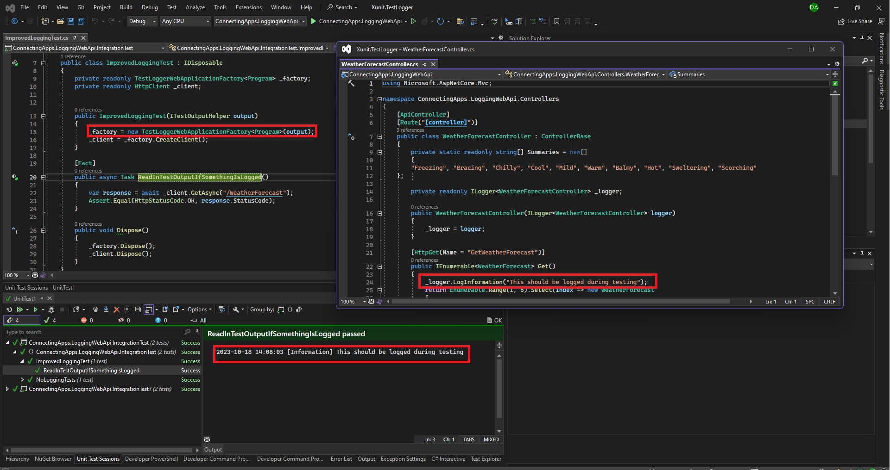

# Xunit.TestLogger

## Before this NuGet package
If you make [integration tests](https://learn.microsoft.com/en-us/aspnet/core/test/integration-tests?view=aspnetcore-10.0) with [xUnit](https://xunit.net/), your logging is gone. You can just see if the test succeeds or fails but you cannot see why as you don't have the logging to help you understanding what happened during the runtime of the test, which makes it hard to solve it.

## Now
The is situation is different now! The problem is solved for modern .NET. Alle you need to do is stop using this way of creating a `WebApplicationFactory`:

```csharp
public NoLoggingTest()
{
    _factory = new WebApplicationFactory<Program>();
}
```

and start creating it this way

```csharp
public ImprovedLoggingTest(ITestOutputHelper output)
{
    _factory = new TestLoggerWebApplicationFactory<Program>(output);
}
```
Here is how it looks like:

[Link To ScreenShot](https://github.com/ConnectingApps/Xunit.TestLogger/blob/main/ScreenForLogging.png?raw=true)


## Supported target frameworks

`net8.0`, `net9.0`, `net10.0` and `net11.0`.

The NuGet package contains a separate build for each of these target frameworks, and each build depends on the `Microsoft.AspNetCore.Mvc.Testing` package of the same major version. So a `net11.0` test project gets the ASP.NET Core 11 testing packages, not the ones of ASP.NET Core 10. The package uses the xUnit v2 `ITestOutputHelper` (`Xunit.Abstractions`).


## In Detail

Assume you have the following controller method (just the method from the template in Visual Studio with some logging added):

```csharp
[HttpGet(Name = "GetWeatherForecast")]
public IEnumerable<WeatherForecast> Get()
{
    // first do some logging
    _logger.LogInformation("This should be logged during testing");
    // Then return an object like it is done in the VS Template
    return Enumerable.Range(1, 5).Select(index => new WeatherForecast
    {
        Date = DateTime.Now.AddDays(index),
        TemperatureC = Random.Shared.Next(-20, 55),
        Summary = Summaries[Random.Shared.Next(Summaries.Length)]
    })
    .ToArray();
}
```

then you can test it like this:
```csharp
using ConnectingApps.Xunit.TestLogger;
using System.Net;
using Xunit.Abstractions;

namespace ConnectingApps.LoggingWebApi.IntegrationTest
{
    public class ImprovedLoggingTest : IDisposable
    {
        private readonly TestLoggerWebApplicationFactory<Program> _factory;
        private readonly HttpClient _client;


        public ImprovedLoggingTest(ITestOutputHelper output)
        {
            _factory = new TestLoggerWebApplicationFactory<Program>(output);
            _client = _factory.CreateClient();
        }

        [Fact]
        public async Task ReadInTestOutputIfSomethingIsLogged()
        {
            var response = await _client.GetAsync("/WeatherForecast");
            Assert.Equal(HttpStatusCode.OK, response.StatusCode);
        }

        public void Dispose()
        {
            _factory.Dispose();
            _client.Dispose();
        }
    }
}
```
 As a result, "This should be logged during testing" will be shown in the test output.

## Asserting on the log output

Seeing the log lines in the test output is nice, but your test can also check them. `TestLoggerWebApplicationFactory` accepts any `ITestOutputHelper`, so you can give it a small recording wrapper. The wrapper keeps every line that is written and passes it on to the real `ITestOutputHelper`, so the test output looks exactly the same as before:

```csharp
using Xunit.Abstractions;

namespace ConnectingApps.LoggingWebApi.IntegrationTest
{
    public sealed class CapturingTestOutputHelper : ITestOutputHelper
    {
        private readonly ITestOutputHelper _inner;
        private readonly List<string> _lines = new();

        public CapturingTestOutputHelper(ITestOutputHelper inner)
        {
            _inner = inner;
        }

        // A snapshot of the lines written so far. ASP.NET Core can log from other threads, hence the lock.
        public IReadOnlyList<string> Lines
        {
            get
            {
                lock (_lines)
                {
                    return _lines.ToArray();
                }
            }
        }

        public void WriteLine(string message)
        {
            lock (_lines)
            {
                _lines.Add(message);
            }

            _inner.WriteLine(message);
        }

        public void WriteLine(string format, params object[] args)
        {
            WriteLine(string.Format(format, args));
        }
    }
}
```

Give the wrapper to the factory instead of the `ITestOutputHelper` itself, and assert on the captured lines:

```csharp
using ConnectingApps.Xunit.TestLogger;
using System.Net;
using System.Text.RegularExpressions;
using Xunit.Abstractions;

namespace ConnectingApps.LoggingWebApi.IntegrationTest
{
    public class LoggingAssertionTest : IDisposable
    {
        private readonly CapturingTestOutputHelper _capture;
        private readonly TestLoggerWebApplicationFactory<Program> _factory;
        private readonly HttpClient _client;

        public LoggingAssertionTest(ITestOutputHelper output)
        {
            _capture = new CapturingTestOutputHelper(output);
            _factory = new TestLoggerWebApplicationFactory<Program>(_capture);
            _client = _factory.CreateClient();
        }

        [Fact]
        public async Task LogLineIsWrittenToTheTestOutput()
        {
            var response = await _client.GetAsync("/WeatherForecast");
            Assert.Equal(HttpStatusCode.OK, response.StatusCode);

            Assert.Contains(_capture.Lines, line => Regex.IsMatch(line,
                @"^\d{4}-\d{2}-\d{2} \d{2}:\d{2}:\d{2} \[Information\] This should be logged during testing$"));
        }

        public void Dispose()
        {
            _factory.Dispose();
            _client.Dispose();
        }
    }
}
```

Every log line has the format `yyyy-MM-dd HH:mm:ss [Level] message`. The time is in UTC and does not depend on the culture of the machine that runs the tests. This test fails when the controller does not log the message, or when the message does not reach the test output. Like the example above, both classes assume the defaults of the `dotnet new xunit` template: implicit usings and a global `using Xunit;`.
